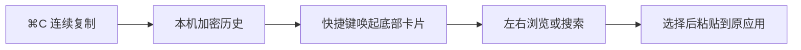

# 拾贴 · ClipShelf

**macOS 原生剪贴板历史工具：连续复制，在屏幕底部预览卡片，再选择粘贴。**

拾贴帮助你找回之前复制过的文字、代码、链接、图片和截图，减少在应用之间反复切换、重新复制的操作。使用 Swift 和 AppKit 编写，常驻菜单栏，离线运行，历史内容加密保存在本机。

当前版本：**1.1.0**。当前构建面向 **Apple Silicon / arm64**，最低部署版本为 macOS 13；已在 macOS 26.5.1 上验证。

## 有什么用

- 写文档：先复制几段参考内容，再逐条选择粘贴。
- 写代码：保留代码、命令和报错信息，维持换行与缩进。
- 整理资料：在同一个历史队列里搜索文字、链接和截图。
- 复用内容：收藏并命名经常使用的文本或链接。



**普通 `⌘C` 和 `⌘V` 保持原来的作用。** 只有主动唤起历史卡片时，才进入选择粘贴流程。

## 主要功能

| 功能 | 说明 |
| --- | --- |
| 连续复制历史 | 自动记录运行期间观察到的新内容，最新内容在前 |
| 底部横向卡片 | 直接展示文字、代码、链接与图片 |
| 横向浏览 | 向左滑动查看更早内容，也支持鼠标滚轮和左右方向键 |
| 搜索与筛选 | 按内容、名称、来源搜索，筛选文本、图片或收藏 |
| 完整预览 | 空格展开全文，长文本可滚动阅读 |
| 选择粘贴 | 双击或回车粘贴，另提供纯文本粘贴和仅复制 |
| 收藏与管理 | 收藏、命名、去重、删除、按时间和数量清理 |
| 隐私控制 | 暂停记录、排除应用、忽略敏感或临时标记 |
| 本地保存 | AES-GCM 加密索引与内容，密钥存入 macOS 钥匙串 |
| 设置 | 自定义快捷键、保存期限、数量及登录时启动 |

## 使用方法

1. 启动拾贴，菜单栏会出现双层方块图标。
2. 在其他应用中正常使用 `⌘C` 连续复制。
3. 把光标放在准备粘贴的输入位置，按唤起快捷键。
4. 在底部卡片中左右浏览，或直接输入关键词搜索。
5. 双击目标卡片，或选中后按回车，粘贴到原应用。

| 按键 | 操作 |
| --- | --- |
| `⌘C` / `⌘V` | 正常复制、直接粘贴当前剪贴板内容 |
| `⌃⌥V` | 首次默认的历史唤起快捷键，可在设置中修改 |
| `←` / `→` | 选择卡片，超出首屏时自动滚入视野 |
| `↩` | 复制所选内容并尝试粘贴到原应用 |
| `⇧↩` | 以纯文本方式粘贴 |
| `⌘↩` | 仅复制所选内容回剪贴板 |
| `Space` | 搜索框为空时展开完整内容 |
| `⌘F` | 聚焦搜索框 |
| `Esc` | 关闭全文预览或卡片栏 |

已有搜索词时，可按下方向键把焦点移到卡片，再按空格展开；也可右键选择「查看完整内容」。中文输入法正在组词时，回车先用于确认候选字。

最初安装的 Mac 已把唤起快捷键设为 **`⇧⌘V`**。这是用户设置；其他 Mac 首次安装仍使用默认的 `⌃⌥V`。

### 管理入口

- 菜单栏左键：打开或关闭卡片栏。
- 菜单栏右键：浏览卡片、管理历史、暂停记录、设置、退出。
- 卡片右键：查看全文、粘贴、仅复制、纯文本粘贴、收藏、删除。
- 「管理历史」保留完整列表与命名操作；唤起快捷键不打开这个大窗口。

## 安装与构建

目前提供源码及本地构建方式，尚未提供 Apple 公证的下载发行包。

需要 Apple Silicon Mac、macOS 13 或以上，以及包含 Swift 和 macOS SDK 的 Xcode Command Line Tools；脚本使用系统 `zsh`、Python 3、OpenSSL、`security` 和 `codesign`，无需第三方 Swift 依赖。已验证编译环境为 Swift 5.8、macOS SDK 13.3；当前脚本固定生成 arm64 应用，Intel 构建尚未验证。

配置好此 Mac 的 GitHub 访问权限后执行：

```sh
git clone git@github.com:stzsl1991/clipshelf.git
cd clipshelf
./scripts/test.sh
./scripts/build.sh
./scripts/install.sh
open /Applications/拾贴.app
```

默认安装到 `/Applications/拾贴.app`，没有目录写权限时改用 `~/Applications/拾贴.app`。更新前先退出拾贴；安装脚本核对 Bundle ID，避免替换同名的其他应用。图标已在仓库中，只有重新生成时才需要运行 `./scripts/icon.sh`。

### 系统授权与签名

自动粘贴需要在 **系统设置 → 隐私与安全性 → 辅助功能** 中允许「拾贴」。未授权时仍可记录、预览与仅复制，再手动 `⌘V`。首次读取加密历史时，macOS 可能弹出钥匙串确认；登录密码只需在系统弹窗中输入。

构建会在 `.signing/` 创建项目专用的本地签名身份。后续更新应保留它，以沿用相同签名身份；此目录及其中密钥不提交到仓库。不安装受信任根证书、不修改系统信任策略，构建结束后恢复原钥匙串搜索列表。

固定签名不能保证免除全部系统提示。若更换签名后，系统开关开启而应用仍提示未授权，并且系统日志明确显示签名规则不匹配，需要重新添加当前应用的授权条目。

## 本地数据与隐私

| 项目 | 默认行为 |
| --- | --- |
| 保存位置 | `~/Library/Application Support/com.shulin.ClipShelf/` |
| 偏好域 | `com.shulin.ClipShelf` |
| 数量与期限 | 最近 1,000 条、最长 30 天，均可修改；收藏不过期 |
| 容量 | 总容量 500 MB，单条原始数据 32 MB；收藏占满时拒绝新增 |
| 加密 | AES-GCM 加密索引与内容，密钥位于本机登录钥匙串 |
| 文件权限 | 历史目录 `0700`，内容文件 `0600` |
| 网络 | 应用没有联网或上传功能；系统备份由用户的备份设置决定 |

默认排除常用密码管理器，忽略敏感、临时及自身回写标记；普通文本中的密码、验证码无法保证全部识别，可手动暂停或排除指定应用。锁屏及用户切换期间暂停采集，恢复后不补录。删除条目时清理载荷，启动时清理本工具的孤立载荷。

`last-paste-status.json` 只记录最近一次操作阶段、权限状态及目标应用标识，不记录剪贴板正文。

## 使用边界

- 约每 200 毫秒检测变化；极短时间内多次覆盖，中间内容可能无法捕获。
- 只记录运行后观察到的新内容，不导入系统旧历史。
- 文件和文件夹引用、云同步、OCR、AI 改写不在当前功能范围内。
- 标准文本、RTF、HTML、PNG、TIFF、JPEG 的粘贴效果由目标应用决定。
- 来源按复制时的前台应用判断，后台复制与通用剪贴板可能有误差。
- 显式选择后先复制，再尝试自动粘贴；只发送一次 `⌘V`，不发送回车或提交表单。
- 原应用关闭、前台应用或可识别的输入位置变化、等待期间发生新复制时，取消自动粘贴。
- 不提供辅助功能焦点信息的应用，只能验证应用身份，不能保证内部光标位置。受保护输入框、远程桌面及特殊编辑器需单独验证。
- 发送按键不等于目标应用已成功插入；应用没有目标应用的成功回执。

## 工程结构

```text
Sources/
  App.swift             生命周期、菜单栏、入口与跨应用粘贴
  Clipboard.swift       剪贴板采集、快捷键、偏好、回写与目标焦点
  Model.swift           模型、去重、限额、加密存储与钥匙串密钥
  CardPicker.swift      底部卡片、搜索、缩略图与全文预览
  CardSupport.swift     卡片选择及滚动、屏幕定位计算
  HistoryWindow.swift   完整历史管理窗口
  SettingsWindow.swift  快捷键、排除应用、保存规则与启动设置
  main.swift            原生应用入口
Resources/              图标与 Info.plist
Tests/                  自动检查、独立验收目标与验证记录
scripts/                构建、安装、签名、图标与预览脚本
```

### 脚本与验证

| 命令 | 作用 |
| --- | --- |
| `./scripts/test.sh` | 当前 45 项检查，使用命名剪贴板，不改系统剪贴板 |
| `./scripts/build.sh` | 编译、打包、签名并严格验证应用 |
| `./scripts/install.sh` | 安装已构建的应用 |
| `./scripts/icon.sh` | 重新生成原生绘制图标 |
| `./scripts/preview.sh` | 从构建产物生成独立示例预览应用 |
| `./scripts/probe.sh` | 构建独立的跨应用粘贴验收目标 |
| `python3 Tests/verify-signing.py` | 检查签名身份稳定及钥匙串搜索列表恢复 |

预览使用独立 Bundle ID、临时加密数据及命名剪贴板，不采集真实剪贴板，也不执行真实跨应用粘贴：

```sh
./scripts/build.sh
./scripts/preview.sh
open build/拾贴预览.app
```

验收目标临时在内存中保存原剪贴板，正常点击「结束验收并恢复原剪贴板」时还原，并把验收结果写入 `/tmp/clipshelf-probe-result.json`。请勿强制结束该验收进程。

已完成的检查及未覆盖范围见 [Tests/VALIDATION.md](Tests/VALIDATION.md)。自动检查不代表已验证每个第三方应用的粘贴兼容性。

## 版本记录

- **1.1.0**：底部横向卡片、正文和图片预览、搜索、全文展开；管理窗口移到菜单栏右键入口。
- **1.0.1**：修复权限检查阻断复制的问题，增加取消原因提示，改用固定本地签名身份。
- **1.0.0**：首版历史采集、加密保存、预览、搜索、收藏、清理与跨应用粘贴。

## 代码管理

仓库只管理源码、图标、脚本、说明与验证记录。构建产物、本机历史、签名私钥、钥匙串文件和环境凭据不纳入版本控制。后续修改完成对应检查后提交并推送到 GitHub；其他设备可从源码构建。

## 卸载

退出拾贴后，把安装的 `.app` 移到废纸篓。历史目录默认保留，便于重装恢复。需要删除历史时，先在设置中「清空全部」；钥匙串条目 `com.shulin.ClipShelf / history-key-v1` 是独立加密密钥，不包含历史正文。
